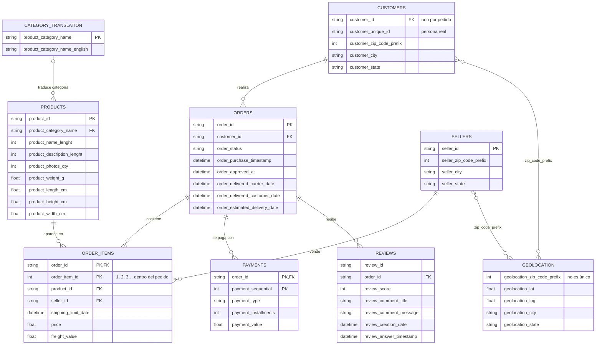

# Curso de pandas intermedio → avanzado

Curso práctico en 10 módulos (cuadernos Jupyter) para pasar de "sé usar pandas" a escribir análisis **correctos, legibles y rápidos** con **pandas 3**. Todo el curso trabaja sobre un mismo caso real: el marketplace brasileño **Olist**.

Cada módulo combina teoría con ejemplos ejecutables, **5 ejercicios con autocomprobación** (⭐ a ⭐⭐⭐) y sus soluciones al final.

---

## Índice

| # | Módulo | Cuaderno | Temas clave |
|---|---|---|---|
| 01 | [pandas 3, dtypes y carga eficiente](#módulo-01--pandas-3-dtypes-y-carga-eficiente) | `01_pandas3_dtypes.ipynb` | dtype `str`, Copy-on-Write, nullable, `category`, Arrow, Parquet |
| 02 | [Indexación avanzada y `MultiIndex`](#módulo-02--indexación-avanzada-y-multiindex) | `02_indexacion_multiindex.ipynb` | `loc`/`iloc`, alineación, `MultiIndex`, `xs`, `DatetimeIndex` |
| 03 | [`groupby` a fondo](#módulo-03--groupby-a-fondo) | `03_groupby_a_fondo.ipynb` | named aggregation, `transform`, `filter`, `apply`, `pd.Grouper` |
| 04 | [Reshape](#módulo-04--reshape) | `04_reshape.ipynb` | `pivot_table`, `melt`, `stack`/`unstack`, `crosstab`, `explode` |
| 05 | [Combinar datos](#módulo-05--combinar-datos) | `05_combinar_datos.ipynb` | `merge` + `validate`, explosión de filas, anti-joins, `merge_asof` |
| 06 | [Series de tiempo](#módulo-06--series-de-tiempo) | `06_series_de_tiempo.ipynb` | `resample`, `rolling`, `ewm`, YoY, zonas horarias, días hábiles |
| 07 | [Texto y datos sucios](#módulo-07--texto-y-datos-sucios) | `07_texto_datos_sucios.ipynb` | `.str`, regex, llaves canónicas, números como texto, calidad |
| 08 | [Method chaining y pipelines](#módulo-08--method-chaining-y-pipelines) | `08_method_chaining.ipynb` | `assign`, `query`, `eval`, `pipe`, depuración, etapas |
| 09 | [Rendimiento](#módulo-09--rendimiento) | `09_rendimiento.ipynb` | vectorización, dtypes, numba, Parquet particionado, chunks |
| 10 | [Extender pandas y proyecto final](#módulo-10--extender-pandas-y-proyecto-final) | `10_extender_pandas_proyecto.ipynb` | accessors propios, `Styler`, Excel, reporte ejecutivo |

---

## Requisitos e instalación

- **Python ≥ 3.11** (mínimo que exige pandas 3.x).
- Dependencias en [`requirements.txt`](requirements.txt): pandas 3, numpy, pyarrow, JupyterLab, openpyxl, numexpr, bottleneck, numba, matplotlib, seaborn, scipy, entre otras.

```bash
python3 -m venv venv
source venv/bin/activate
pip install -r requirements.txt
jupyter lab
```

Para comprobar el entorno, ejecuta `verify.ipynb`: debe mostrar el Python del entorno virtual y pandas 3.x.

## Cómo usar el curso

1. Se recomienda seguir los módulos **en orden**: avanzan de los fundamentos (dtypes, índices) hasta el proyecto final.
2. Ejecuta las celdas de arriba hacia abajo. Cada cuaderno es **autocontenido**: su sección `0 · Setup` carga lo que necesita desde `data/`.
3. En cada ejercicio encontrarás:
   - una celda `# TU CÓDIGO AQUÍ` con variables inicializadas en `...`;
   - una celda de **comprobación** que muestra `⏳ pendiente` mientras no lo resuelvas y `✅ correcto` cuando los `assert` pasan.
4. Intenta resolver antes de mirar la sección **✅ Soluciones** al final del cuaderno.

> Los resultados esperados de los ejercicios están calculados sobre la muestra de `data/`. Si la modificas, restaura los CSV desde `data_samples/`.

## El dataset: Olist Brazilian E-commerce

Una muestra pequeña (cientos de filas por tabla) del dataset público de Olist, para que todo se ejecute al instante:

| Tabla | Archivo | Filas aprox. |
|---|---|---|
| Clientes | `olist_customers_dataset.csv` | 300 |
| Pedidos | `olist_orders_dataset.csv` | 300 |
| Ítems de pedido | `olist_order_items_dataset.csv` | 336 |
| Pagos | `olist_order_payments_dataset.csv` | 309 |
| Reseñas | `olist_order_reviews_dataset.csv` | 302 |
| Productos | `olist_products_dataset.csv` | 296 |
| Vendedores | `olist_sellers_dataset.csv` | 212 |
| Geolocalización | `olist_geolocation_dataset.csv` | 2000 |
| Traducción de categorías | `product_category_name_translation.csv` | 71 |



Puntos importantes que se usan durante todo el curso:

- Un **pedido** puede tener varios **ítems** (`order_item_id` = 1, 2, 3…), varios **pagos** (`payment_sequential`) y, en algunos casos, más de una **reseña**.
- `customer_id` es **por pedido**; la persona real se identifica con `customer_unique_id`.
- `geolocation` tiene **muchas coordenadas por prefijo postal**: unirla sin agregar primero multiplica filas (relación muchos a muchos en el diagrama).
- Algunos productos no tienen `product_category_name`, por eso la relación con `category_translation` es opcional.

---

## Contenido detallado

### Módulo 01 · pandas 3, dtypes y carga eficiente

**Objetivo:** entender los cambios de pandas 3 que más rompen código viejo y cargar datos con los tipos correctos desde el inicio.

1. **Conociendo el modelo de datos de Olist**: tablas, llaves y relaciones.
2. **Cambios clave de pandas 3**
   - El texto ya no es `object`: es `str`.
   - Copy-on-Write (CoW) siempre activo.
3. **Auditar dtypes y memoria** con `memory_usage(deep=True)`.
4. **Leer con el dtype correcto** desde el inicio: `dtype=`, `parse_dates=`, `usecols=`.
5. **Dtypes nullable y `pd.NA`**: `Int64`, `Float64`, `boolean`; `pd.NA` vs `NaN`.
6. **`category`**: categorías ordenadas y categorías no observadas.
7. **Fechas y duraciones.**
8. **Backend PyArrow y Parquet**: guardar los tipos junto con los datos.
9. **Patrón: esquema declarativo de dtypes.**

**Ejercicios:** reseñas bien tipadas ⭐ · códigos postales rotos ⭐ · arregla el código (Copy-on-Write) ⭐⭐ · categorías sin traducción ⭐⭐ · reto: benchmark de memoria en `geolocation` ⭐⭐⭐

### Módulo 02 · Indexación avanzada y `MultiIndex`

**Objetivo:** usar el índice como una herramienta (llave, alineación, jerarquía) y no como un estorbo.

1. **Repaso de selección**: `loc`, `iloc`, `at` y cómo construir máscaras legibles.
2. **El índice como llave**: `set_index`, índices no únicos, ordenar el índice.
3. **Alineación por índice**: el origen de muchos `NaN` misteriosos, la alineación como herramienta y `reindex`.
4. **Crear un `MultiIndex`.**
5. **Seleccionar en un `MultiIndex`**: `pd.IndexSlice`, `.xs` (*cross-section*) y máscaras con `get_level_values`.
6. **Manipular niveles**: `swaplevel`, `droplevel`, `rename_axis`, agregar por nivel.
7. **`MultiIndex` en columnas** y cómo aplanarlas.
8. **`DatetimeIndex`** con selección por strings parciales.

**Ejercicios:** llave compuesta ⭐ · lookups con `map` en lugar de `merge` ⭐ · navegando un `MultiIndex` ⭐⭐ · `DatetimeIndex` ⭐⭐ · reto: columnas jerárquicas ⭐⭐⭐

### Módulo 03 · `groupby` a fondo

**Objetivo:** pensar en *split → apply → combine* y saber qué forma tiene el resultado de cada operación.

1. **El objeto `GroupBy`**: `size` vs `count`, iterar sobre grupos.
2. **`agg` y agregaciones con nombre** (*named aggregation*) y funciones propias.
3. **Llaves múltiples y parámetros**: `as_index`, `observed` con categorías, `dropna` y llaves faltantes, `sort`.
4. **`transform`**: valores de grupo sin perder filas y patrones típicos.
5. **`filter`**: quedarse con grupos completos que cumplen una condición.
6. **`apply` y top-N por grupo**: cambios de pandas 3 y tres formas de obtener el top-N.
7. **Agrupar por tiempo con `pd.Grouper`.**
8. **Rendimiento**: elegir la opción más rápida.

**Ejercicios:** agregaciones con nombre ⭐ · `transform` dentro del pedido ⭐⭐ · `filter` vs máscara ⭐⭐ · top-N y `nth` ⭐⭐ · reto: desempeño logístico por estado ⭐⭐⭐

### Módulo 04 · Reshape

**Objetivo:** pasar con soltura entre formato largo (*tidy*) y ancho según lo que necesites.

1. **Largo vs ancho**: cuándo conviene cada uno.
2. **`pivot` y `pivot_table`**: `pivot` solo reorganiza; `pivot_table` agrega (`aggfunc`, `fill_value`, `margins`).
3. **`melt`**: de ancho a largo.
4. **`stack` / `unstack`**: en pandas 3 `stack` ya no descarta `NaN`; patrón *unstack → operar → stack*.
5. **`crosstab`**: tablas de contingencia y normalización.
6. **`explode`**: desanidar listas, por ejemplo las palabras de las reseñas.
7. **`get_dummies` y `from_dummies`**: variables indicadoras.

**Ejercicios:** reporte mensual con `pivot_table` ⭐ · `melt` de dimensiones ⭐⭐ · `crosstab`: ¿la entrega tardía baja la calificación? ⭐⭐ · `unstack` → operar → `stack` ⭐⭐ · reto: vocabulario de reseñas buenas vs malas ⭐⭐⭐

### Módulo 05 · Combinar datos

**Objetivo:** unir tablas sin inflar totales en silencio, razonando sobre la cardinalidad de las llaves.

1. **Cardinalidad de llaves**: 1:1, 1:m, m:m.
2. **`merge` a fondo**: tipos de unión (`how`), llaves con distinto nombre y sufijos, `indicator=True`, tipos de llave incompatibles.
3. **`validate`**: contratos sobre tus datos.
4. **La explosión de filas**: cómo detectarla y evitarla.
5. **Semi-joins y anti-joins**: "los que sí están" y "los que no están".
6. **Caso práctico: geolocalización y distancias.**
7. **`join` y uniones por índice.**
8. **`concat`** y el antipatrón de concatenar dentro de un bucle.
9. **`merge_asof`**: uniones por cercanía en el tiempo.
10. **`combine_first`**: completar datos de dos fuentes.

**Ejercicios:** contratos y deduplicación ⭐ · conciliación pedido vs pago ⭐⭐ · distancias por estado ⭐⭐ · `concat` de eventos ⭐⭐ · reto: `merge_asof` con tipo de cambio ⭐⭐⭐

### Módulo 06 · Series de tiempo

**Objetivo:** convertir eventos irregulares en series útiles y compararlas en el tiempo.

1. **Tipos de tiempo y parseo**: `Timestamp`, `Timedelta`, `Period`, `DateOffset`; parseo con control; duraciones entre fechas.
2. **De eventos a una serie regular**: `asfreq` vs `resample` vs `reindex`.
3. **`resample`**: `label` y `closed`; *upsampling* de mensual a diario.
4. **`rolling`**: ventanas por tiempo sobre eventos irregulares, más estadísticas y ventanas por grupo.
5. **`expanding` y `ewm`.**
6. **`shift`, `diff`, `pct_change` y crecimiento anual (YoY).**
7. **Zonas horarias** y horario de verano (DST).
8. **Periodos y días hábiles**: `Period`, `PeriodIndex` y calendarios de días hábiles.
9. **Patrones día × hora.**

**Ejercicios:** `resample` semanal ⭐ · ventanas móviles ⭐⭐ · crecimiento anual (YoY) ⭐⭐ · zonas horarias ⭐⭐ · reto: promesa de entrega en días hábiles ⭐⭐⭐

### Módulo 07 · Texto y datos sucios

**Objetivo:** limpiar, normalizar y validar texto real, con el dtype `str` de pandas 3.

1. **El accessor `.str` en pandas 3**, incluidos los faltantes.
2. **Limpieza básica**: espacios, mayúsculas, acentos, saltos de línea y puntuación.
3. **Expresiones regulares**: `contains`, `match`, `fullmatch`; `extract`; `extractall` y `findall`; `replace` con grupos y funciones; `count` y clasificación por temas.
4. **`split`, `partition` y `cat`.**
5. **Llaves canónicas y coincidencias aproximadas**: que "São Paulo", "sao paulo " y "SAO-PAULO" sean lo mismo.
6. **Valores "casi faltantes" y números sucios**, como el formato brasileño `R$ 1.234,56`.
7. **Validación y reporte de calidad**, incluidos los duplicados "ocultos".
8. **Rendimiento con texto.**

**Ejercicios:** normalizar títulos ⭐ · etiquetado por regex ⭐⭐ · ciudades de clientes y vendedores ⭐⭐ · precios en formato brasileño ⭐⭐ · reto: reporte de calidad de `customers` ⭐⭐⭐

### Módulo 08 · Method chaining y pipelines

**Objetivo:** escribir transformaciones como una cadena legible de arriba hacia abajo y organizarlas en etapas reutilizables.

1. **¿Por qué encadenar?** Estilo imperativo vs estilo encadenado.
2. **`assign`**: por qué `lambda d:` y no `items["price"]`; nombres que no son identificadores válidos.
3. **`query`** con variables externas; `query` vs `loc[lambda d: ...]`.
4. **`eval`** para fórmulas.
5. **`pipe`**: cuando el DataFrame no es el primer argumento; `pipe` en `GroupBy`.
6. **Otros métodos amigables con las cadenas.**
7. **Depurar una cadena** sin romperla.
8. **Pipelines por etapas**: funciones pequeñas, probables y reutilizables.
9. **Antipatrones.**

**Ejercicios:** refactorizar a una cadena ⭐ · `query` con variables y nombres raros ⭐ · fórmulas con `eval` ⭐⭐ · etapas con `pipe` ⭐⭐ · reto: *scorecard* de vendedores ⭐⭐⭐

### Módulo 09 · Rendimiento

**Objetivo:** medir antes de optimizar y conocer las palancas que de verdad aceleran pandas.

> Este módulo escala la muestra a ~1 millón de filas **sintéticas** para que las diferencias se noten. Tarda unos minutos y escribe archivos grandes en `cache/m09/` (varios GB), que puedes borrar al terminar.

1. **Medir**: tiempo y memoria.
2. **Vectorización**: reemplazar bucles y `apply`.
3. **Lógica condicional vectorizada.**
4. **Lookups rápidos.**
5. **Copy-on-Write y memoria**: por qué `.copy()` casi nunca hace falta.
6. **Dtypes para rendimiento**: memoria (*downcast*, `category`, Arrow) y velocidad de `groupby` con llaves `category` vs `str`.
7. **numba** para funciones propias sin alternativa vectorizada.
8. **I/O**: CSV vs Parquet, particiones y filtros, lectura por chunks.
9. **Checklist de rendimiento.**

**Ejercicios:** vectorizar una regla de negocio ⭐ · optimizador de memoria automático ⭐⭐ · agregación por chunks ⭐⭐ · numba para una métrica propia ⭐⭐ · reto: dataset particionado y consulta eficiente ⭐⭐⭐

### Módulo 10 · Extender pandas y proyecto final

**Objetivo:** empaquetar la lógica de tu dominio, presentar resultados y unir todo el curso en un proyecto.

1. **Accessors propios** (`df.miaccessor.metodo()`): uno de Series para datos de Brasil y uno de DataFrame con validación.
2. **`Styler`**: formatos, colores, barras; estilos propios con `map` (por celda) y `apply` (por columna o fila).
3. **Exportar**: Excel con varias hojas y Parquet (en `salida/`).
4. **🏁 Proyecto final: reporte ejecutivo de Olist**, de los CSV crudos al reporte.

**Ejercicios:** accessor de calidad ⭐ · una tabla presentable ⭐⭐ · 🏁 tabla de hechos por pedido ⭐⭐⭐ · 🏁 KPIs ⭐⭐⭐ · 🏁 el reporte ⭐⭐⭐

Cierra con un resumen del curso y siguientes pasos sugeridos.

---

## Estructura del proyecto

```
pandas-study/
├── 01_…ipynb … 10_…ipynb   # módulos del curso
├── verify.ipynb            # comprobación del entorno
├── data/                   # muestra de Olist que usan los cuadernos
├── data_samples/           # copia de respaldo de data/
└── requirements.txt
```

Al ejecutar los cuadernos se generan `cache/` (módulos 01 y 09) y `salida/` (módulo 10). Son resultados intermedios y se pueden borrar sin problema.
